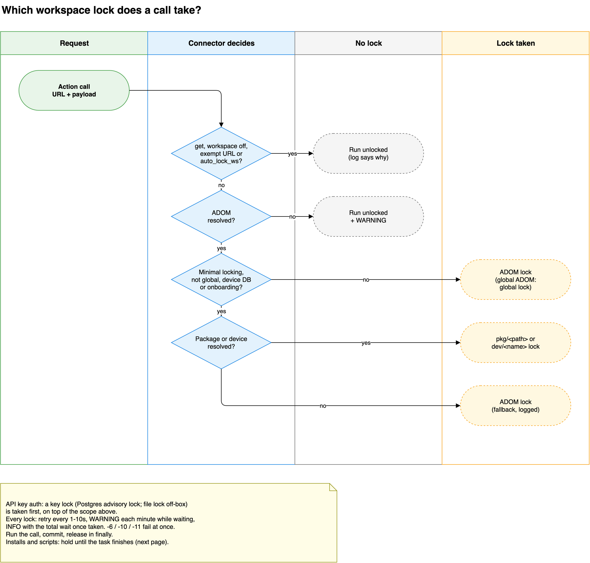
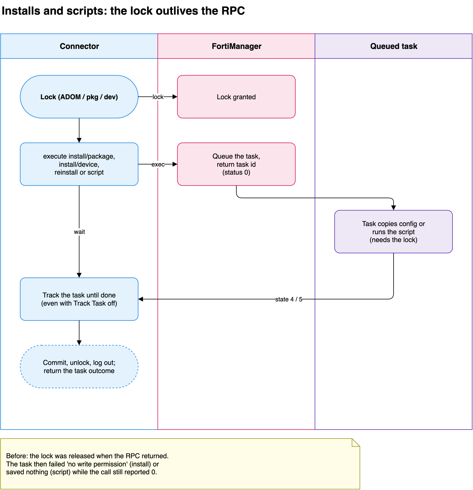
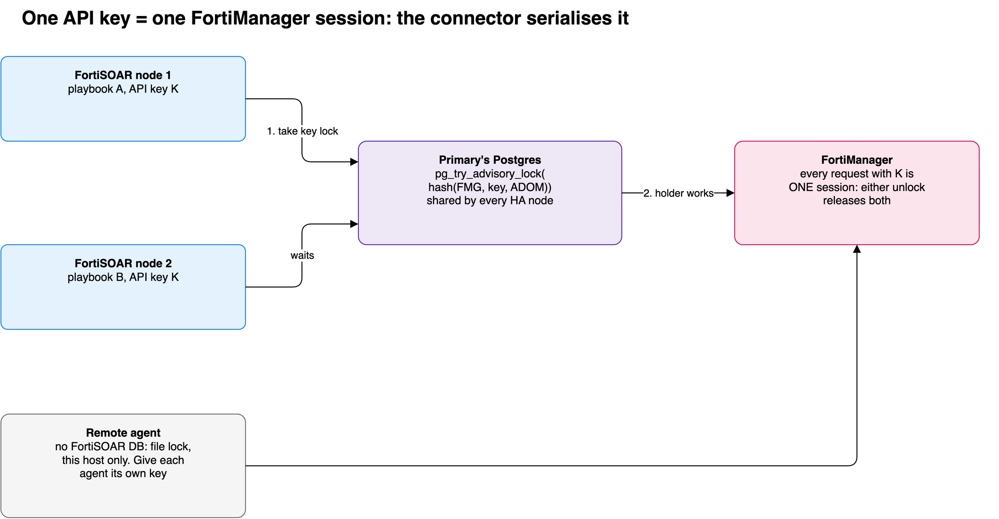
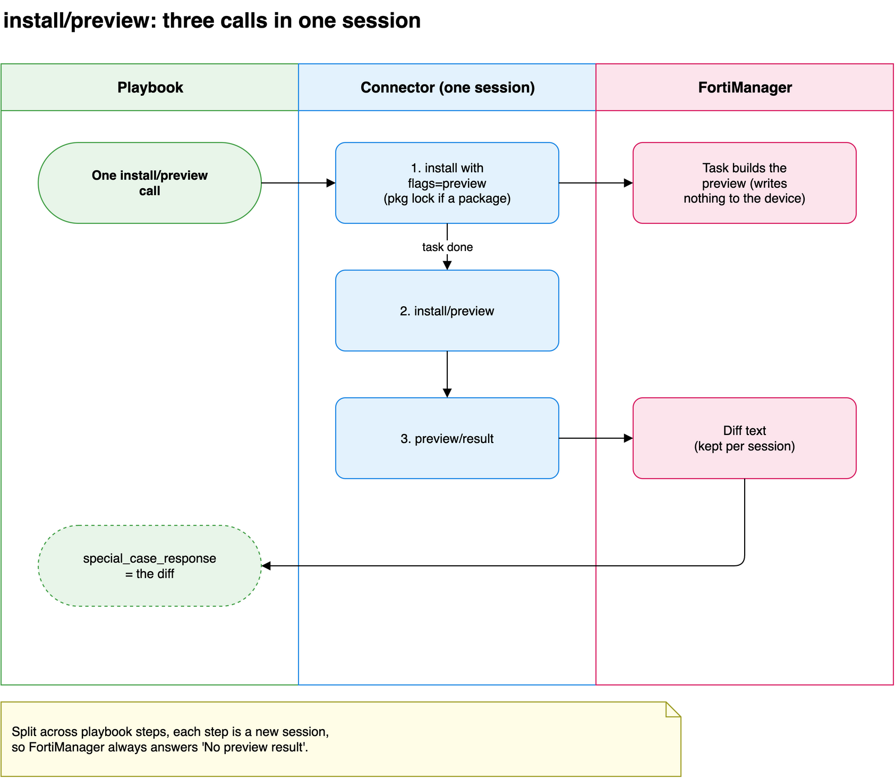

# How the connector works

The actions are thin: each one sends the URL and payload you give it to FortiManager's
JSON-RPC API. What the connector adds is everything around that call that FortiManager
expects a client to do itself, and that a playbook author would otherwise have to get
right in every playbook. This page explains what that is and why.

Every behaviour below was measured against a live FortiManager (7.6.x and 8.0.0), not
assumed. The probes that measured them are in `tests/live/`, and the reasoning is in the
comments in `generic_json_rpc.py` next to each rule. The diagrams are generated by
`docs/diagrams/build_diagram.py` (edit it and rerun; it validates the layout).

## One call, one session

Each action logs in, does its work and logs out. Nothing is kept between steps. This
matters because FortiManager keeps some state per session (workspace locks and preview
results), so anything that has to happen "in the same session" happens inside a single
connector call.

## Workspace locking

When workspace mode is on, FortiManager refuses writes (`-10147 no write permission`)
from a session that has not locked what it writes to. It does not take the lock for you.
The connector does:

1. **Decide whether a lock is needed.** No lock is taken for:
   - a `get`;
   - an appliance with workspace mode off;
   - a payload that asks FortiManager to lock server-side (`flags: auto_lock_ws`);
   - URLs that are read-only or need no lock (`NO_LOCK_URLS`). These are the install
     preview and preview result, `/sys/proxy/json`, firmware upgrade, and the read-only
     `/um/` queries.

   Taking a lock that isn't needed is not harmless. It makes the call wait behind any
   other writer in the ADOM.
2. **Find the ADOM** from the URL (`/adom/<name>/`, or `/pm/config/global/...` for the
   global ADOM) or the payload's `adom`. If no ADOM resolves, the call goes ahead unlocked
   and logs a warning.
   - The global ADOM takes the global lock, even with Minimal Locking on, because it has
     no package or device locks. With ADOMs enabled, FortiManager refuses unlocked global
     writes. With ADOMs disabled there is no global lock, and the write goes ahead without
     one.
3. **Pick the scope.**
   - By default, the whole ADOM is locked.
   - With **Minimal Locking** on, only the policy package (`pkg/<path>`) or device
     (`dev/<name>`) the request touches is locked. The scope is resolved from the URL or
     the payload, and nested package folders are resolved against the ADOM's real
     package list. When no finer scope can be resolved, the ADOM is locked and the call
     logs that it fell back.
   - With `per-policy-lock` enabled on the FortiManager, a `set` or `delete` of one
     firewall policy locks just that policy. Two workers can then edit different policies
     in one package at the same time, and the same policy still excludes the second one.
     The commit is made at package level, because a policy-level commit saves nothing.
     With the setting off, the package is locked as before.
   - CLI scripts against the device database are fine under a device lock. Unlike
     direct device-database writes, they mark the device as modified, so the next
     install picks the change up.
   - Templates, template groups, provisioning profiles, SD-WAN templates, device groups
     and ADOM objects all need the ADOM lock, which was measured live, so they use it.
   - Some URLs always take the ADOM lock, even with Minimal Locking on:
     - device onboarding (`/dvm/cmd/*`), where FortiManager offers no finer lock;
     - device-database writes (`/pm/config/device/...`). A write made under a device
       lock reports success but doesn't mark the device modified, so the next
       install/device skips the change.
4. **Acquire, with retries.** A busy lock is retried with a random 1-10s back-off, for
   up to 1500 attempts.
   - A lock that FortiManager rejects permanently fails straight away instead of being
     retried. That covers a nonexistent ADOM, package or device, and no permission
     (`-6`, `-10`, `-11`).
   - While a call waits, it logs a `WARNING` every minute. Once it gets the lock, it logs
     the total wait.
   - A worker that dies holding a lock (Username/Password) keeps it until FortiManager's
     idle timeout ends its session, about 15 minutes measured. A second session can't
     release it.
5. **Run the call, commit, release.** The release happens in a `finally` block, so a
   failed call never leaves a package or device locked.

### Installs and scripts hold the lock until the task finishes

`install/package`, `install/device`, `reinstall/package` and CLI `script/execute`
return a task id immediately, and the actual copy to the FortiGate happens afterwards. If the lock is
released when the RPC returns, the task fails with "no write permission" while the RPC
call still reports success.

A script against the device or ADOM database has the same problem. Without the lock
while it runs, the task fails with "No permission for the resource", even though the
call itself returned 0.

For these URLs the connector therefore follows the task to completion before it
releases the lock, even when **Track Task** is off. It also returns the task outcome,
so a failed install doesn't show up as a success.

## Shared API keys

FortiManager treats **every request made with one API key as one session**. Two
playbooks using the same key therefore both "own" an ADOM lock, and when either one
unlocks, the lock is gone for the other, whose write then fails. FortiManager can't tell
the two apart, so the connector serialises them itself.

- **What is serialised:** each workspace-locking call made with an API key first takes a
  connector-side lock keyed on (FortiManager, key, ADOM). It holds that lock until its
  FortiManager session has closed. Calls on different ADOMs or different keys don't wait
  for each other, and Username/Password configurations aren't affected.
- **Inside FortiSOAR:** the lock is a PostgreSQL advisory lock in FortiSOAR's own
  database.
  - In an active-active HA cluster, every node uses the primary's database, so the lock
    holds across nodes.
  - The lock belongs to the database connection, and that connection closes at the end
    of every request, so a crashed worker cannot leave it held.
- **On a remote agent**, or anywhere without FortiSOAR's database, a local file lock is
  used instead. It only covers workers on that host, so give each agent its own API key
  or use Username/Password.
- **Timeout:** a call waits up to an hour for a sibling on the same key, then fails with
  an error that names the shared key.

## Special cases: calls that need a follow-up

Some FortiManager calls are only useful together with a second call, made in the same
session. The connector runs the whole sequence for you (`SPECIAL_CASES`).

- **`/securityconsole/install/preview`.** A preview needs three calls:
  1. a preview-flagged install;
  2. the preview itself;
  3. the result.

  FortiManager keeps preview state per session, and the connector logs in fresh for
  every action, so if you split these across playbook steps you always get "No preview
  result". One `install/preview` call through the connector runs all three and returns
  the diff.
  - The response has the preview text in `special_case_response`, and the install it ran
    in `special_case_prepare`.
  - A package preview takes the package lock for its preview install, which is required
    in workspace mode.
  - The preview writes nothing to the FortiGate.
  - If any step fails, the call fails. It never returns status 0 with an empty preview.

## Freeform batches

A **JSON RPC Freeform** batch is locked as a whole:
- If every request touches the same package or device, that is locked. Otherwise the
  ADOM is locked.
- A batch that writes to more than one ADOM is refused in workspace mode, because one
  call can hold only one ADOM's lock. Split it into one batch per ADOM.
- A batch with a failing request reports that request's code as its status. A
  successful batch reports 200, as it always has.

## Errors you can trust

- The top-level `status` comes from the RPC call, or from the task when you asked for
  tracking.
- A failed install task, a failed special-case follow-up or a failed preview install
  each turns a status of 0 into a failure.
- When there's no task to track, the response says why, for example FortiManager's own
  "No devices" message.

## Reading the log

Every call logs whether it locked, and if it didn't, why. It also logs the scope it
locked and how long it held the lock, which is the figure other workers wait on. These
lines are written at `DEBUG` and `INFO`. FortiSOAR records connector logs at `WARNING`
and above by default, so raise `connector_logger_level` to see them. Failed releases and
commits are logged at `WARNING` or `ERROR`, so they're recorded either way.
